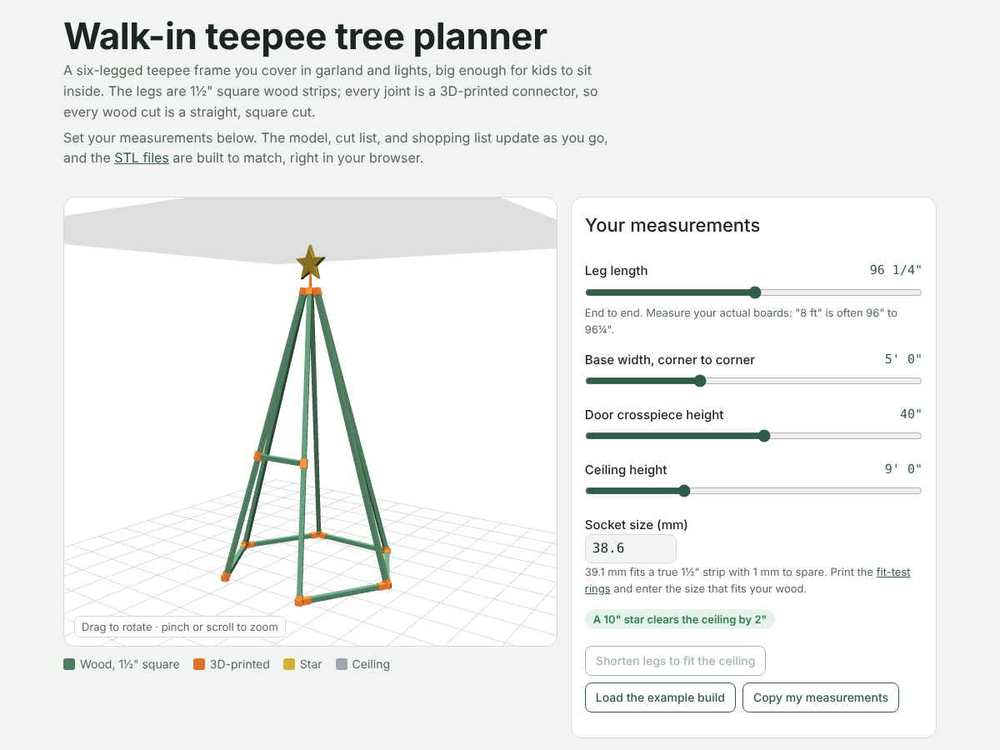

# Walk-in teepee tree

A six-legged teepee frame you cover in garland and lights: a Christmas tree kids can sit inside. The legs are 1½" square wood strips, and every joint is a 3D-printed connector, so every wood cut is a straight, square cut.

This repo generates those connectors for **your** measurements.

- **Planner (no install):** <https://lacyrohde.github.io/christmas-teepee/>. Set leg length, base width, door height, ceiling and socket size; see a 3D preview, cut list, and shopping list; download the STLs, built in your browser.
- **MakerWorld:** listing coming soon, with a print profile for the example build and a **Customize** button (OpenSCAD).
- **Command line:** `node cli/generate.mjs` (below).



## What you print

| Part | Qty | Job |
|---|---|---|
| `top_hub` | 1 | Holds the six leg tops and the star post. A boss underneath takes a ¼"-20 eye bolt for a disco ball. |
| `star_post` | 1 | 6" cone, 1" tapering to ½", that most spring-coil and tube-style star toppers grip. |
| `base_corner_2arm` | 4 | Joins two base pieces at 120° and holds a leg foot. |
| `doorway_corner_left` / `_right` | 1 each | The open ends of the U-shaped base, either side of the door. |
| `crosspiece_sleeve_left_leg` / `_right_leg` | 1 each | Slide onto the front legs and hold the door crosspiece level. |
| `fit_test_*` | 3 | Short rings 0.5 mm apart for finding your socket size. Print these first. |

"Left" and "right" are as seen standing outside, facing the door.

## Quick start

1. Cut a short piece of your wood. Print the three fit-test rings (from the planner, or `examples/fit-test-rings/`).
2. Slide them onto the strip. The one that goes on by hand with light friction and doesn't wobble is your socket size.
3. In the planner, enter that size plus your leg length, base width, door height and ceiling height. Check that the star clears the ceiling.
4. Download the STLs and print (settings below).
5. Cut the wood from the planner's cut list and assemble.

## Measurements

| Input | Range | Notes |
|---|---|---|
| Leg length | 72–120 in | End to end. Measure your boards; "8 ft" is often 96" to 96¼". |
| Base width | 48–84 in | Corner to corner at the feet. Sets the doorway width: the opening at the floor is about half the base width, less 2½". |
| Door height | 24–54 in | Centre of the crosspiece. Doesn't change any printed part; it sets the crosspiece length. |
| Ceiling | 84–168 in | Only used to check that a 10" star on the post clears it. |
| Socket size | 37.5–40.5 mm | From your fit test. 39.1 mm fits a true 1½" strip with 1 mm to spare. Sleeves are made 0.5 mm looser so they slide. |

Leg length and base width set the lean angle (kept under 30°); every socket angle comes from that.

## Printing

- **Material:** PETG. PLA creeps under constant load and cracks rather than bends.
- **Settings:** 0.20mm Standard with Arachne walls, 4 walls, 20% gyroid infill and 4 top and bottom layers. Arachne widens the inner wall lines so the 4 mm socket walls print fully solid, with no gap fill down the middle; infill only fills the thick cores, which carry light compression.
- **Orientation:** export orientation is print orientation.
  - **No supports on any part.** Every socket that lies sideways has a sloped roof above the square part the wood sits in, topped with a short flat bridge (about 10 mm), and the sleeves have a solid foot under the side socket.
  - Hub: upside down, sockets up. The only flat span is a 16 mm ceiling over the eye-bolt seat, which bridges cleanly.
  - Corners: flat, as exported.
  - Star post: standing, with a 10 mm brim (it is 176 mm tall on a 22 mm base).
- **Bed:** the hub is about 186 mm across.
- **Filament:** about 1.2 kg for a full set.

The example in `examples/96.25in-legs-60in-base-38.6mm/` is the build the MakerWorld profile is made from: 96¼" legs, 60" base, crosspiece at 40", 9 ft ceiling, 38.6 mm sockets.

## Hardware

- 10 × #8 × 1¼" **flat-head** wood screws for the base corners: they go up through countersunk holes in the bottom of each arm (assemble the base upside down, then flip it)
- 2 × #8 × 1¼" wood screws for the sleeves
- Disco ball mount (optional): ¼"-20 × 1" forged eye bolt and a ¼"-20 nylon lock nut. The nut slides into a slot in the side of the boss under the hub; thread the eye bolt up into it. No washer or drilling.

## Wood

All pieces are 1½" × 1½" (sold as 2×2s). The planner gives exact lengths. For the example build, buy 8 boards at 96¼":

- 6 legs at full length (no cuts)
- 5 base pieces at 27"
- 1 door crosspiece, about 15¼", cut last to fit between the sleeves

The base pieces and crosspiece come out of the last two boards (27 + 27 + 27, and 27 + 27 + crosspiece).

Paint the wood before fitting it, or leave the last 2" of each end bare: paint adds thickness and the sockets are snug.

## Assembly

1. Build the U-shaped base upside down: four 2-arm corners, two doorway corners, five base pieces, one flat-head screw up through the bottom of each arm. Flip it over.
2. If you're hanging a disco ball, slide the nylon lock nut into the slot on the side of the boss under the hub and thread the eye bolt up into it. Then press in the star post.
3. Slide a sleeve onto each front leg **before** standing them up.
4. Drop three legs into alternating corners, lean them together, and press the hub onto their tops from a ladder.
5. Add the other three legs: foot first, then tip the top into its socket.
6. Slide the sleeves to door height, measure between them, cut the crosspiece, set it in, and screw the sleeves.
7. Lights, garland, star.

**Safety:** LED lights only. Push on the finished frame from every direction before decorating, and don't let anyone climb it. Keep cords tucked behind a base corner, away from pets and small hands.

## Command-line generator

```sh
npm install
node cli/generate.mjs --leg 96 --base 60 --door 40 --ceiling 108 --socket 39.1 --out out/
node cli/generate.mjs --fit-test --socket 39.1 --out out/fit/
npm run example   # regenerates examples/96.25in-legs-60in-base-38.6mm
```

Writes one STL per unique part and a `params.json` with the lean, heights, cut lengths and a filament estimate.

## How it's built

- `docs/parts.js`: the geometry, as code, using [manifold-3d](https://github.com/elalish/manifold). Shared by the planner and the CLI.
- `docs/index.html`: the planner (GitHub Pages serves `docs/`). Loads three.js, JSZip and manifold-3d from jsDelivr/cdnjs.
- `cli/generate.mjs`: Node CLI around `parts.js`.
- `openscad/teepee_tree_connectors.scad`: the same parts in OpenSCAD 2021.01 for MakerWorld's Customize button. Its output matches the JS version to within 0.1 cm³ per part.

To serve the planner locally: `npx serve docs` (it must be served over http, not opened as a file, because it uses ES modules).

### Publishing the planner

Settings → Pages → Deploy from a branch → `main`, folder `/docs`. Once the MakerWorld listing is live, add its link to this README.

## License

MIT, see `LICENSE`. That covers the code (`docs/`, `cli/`, `openscad/`), the example STLs and 3MF, and the models the planner generates. The MakerWorld listing is shared under CC BY 4.0, MakerWorld's closest equivalent.
